<div align="center">

# 雾都·十八梯 · Foggy 18 Stairs

**一座纯代码生成的重庆赛博朋克雨夜山城 —— 可以走进去的 three.js 场景**

没有模型文件、没有贴图素材：楼、招牌、行人、雨、积水反射、江对岸的巨构城，全部由程序在浏览器里实时生成。

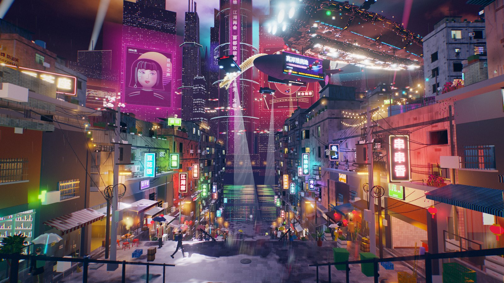

`three.js 0.170` · 无构建步骤 · 第一人称漫游 · 雨夜 / 阴雨白天切换

</div>

---

## 截图

| 雨夜 | 阴雨白天 |
| :---: | :---: |
| 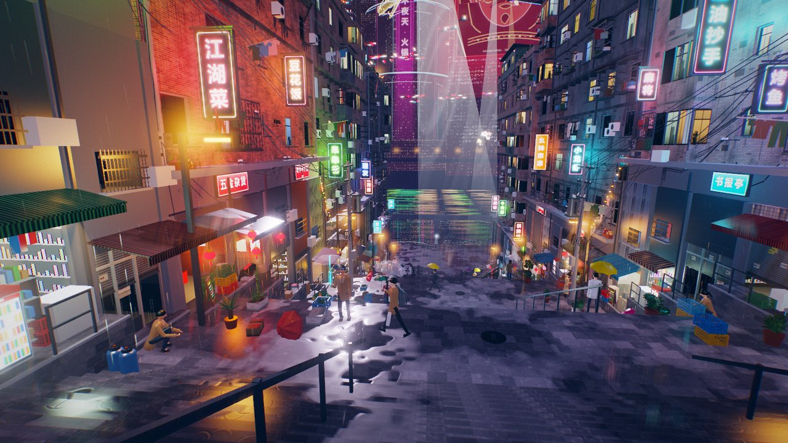 | 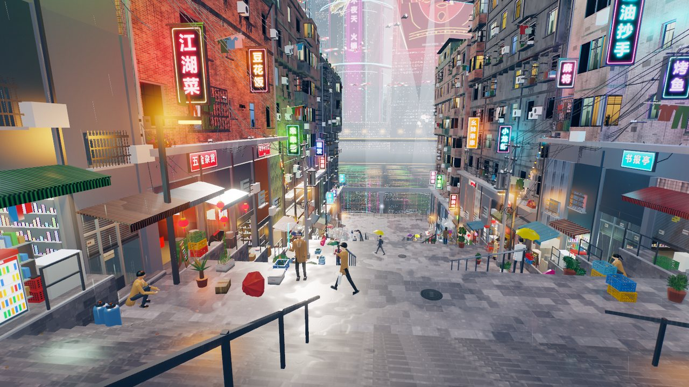 |
| 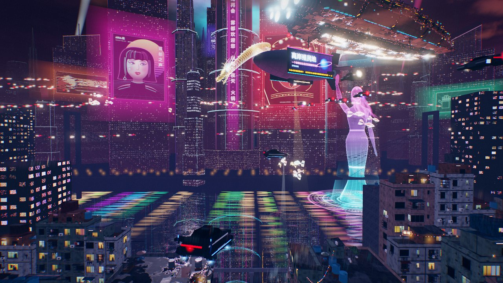 | 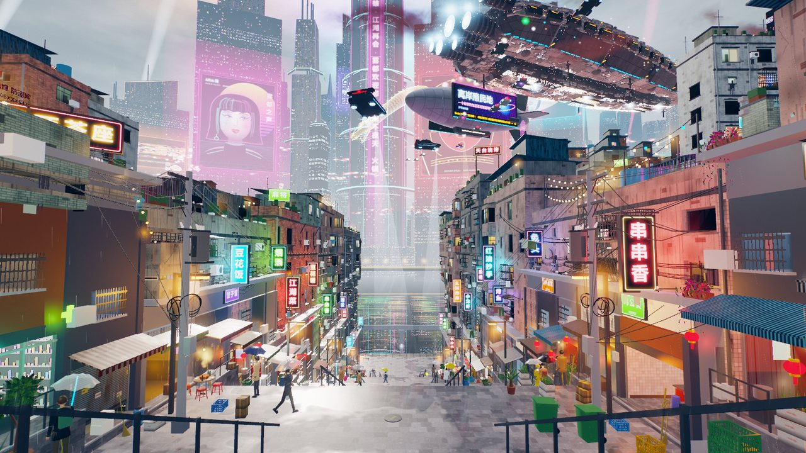 |

**坡底观景平台**：积水倒映出江对岸的巨屏与全息巨人，雨点在水面打出涟漪。

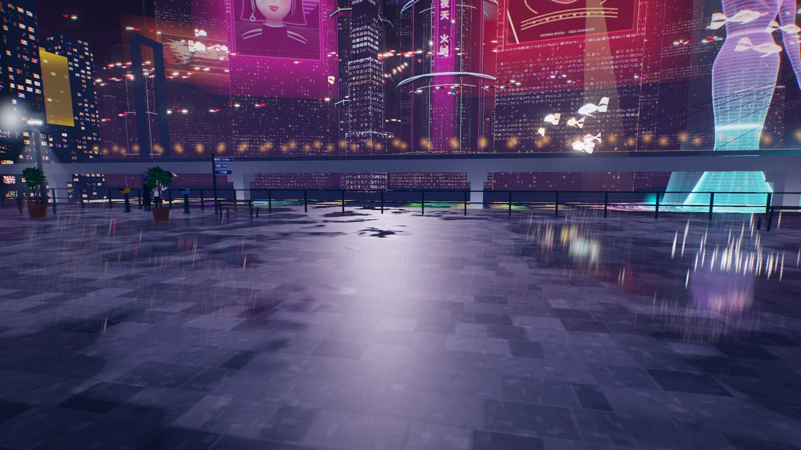

### 可以走到的地方

| 梯后老街 | 黄葛树小广场 |
| :---: | :---: |
| 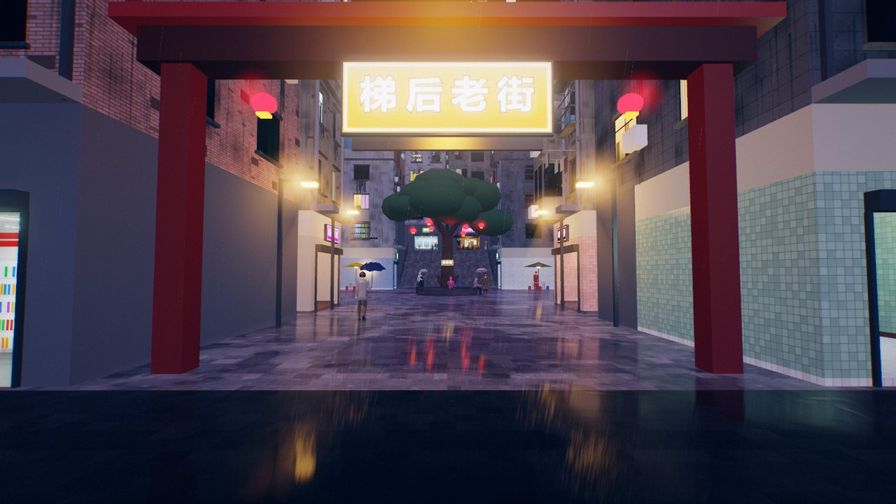 | 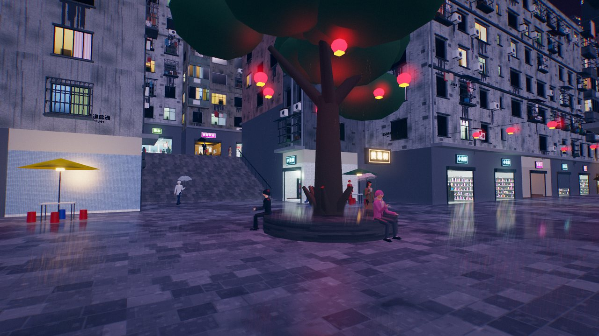 |
| **山坡巷** | **后山梯道** |
| 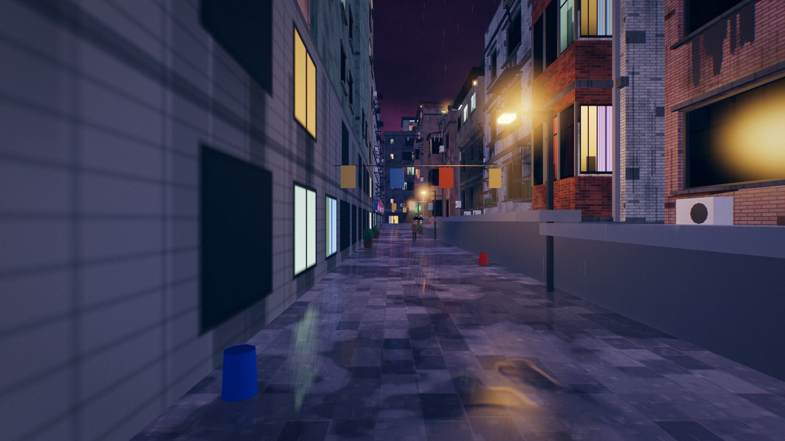 | 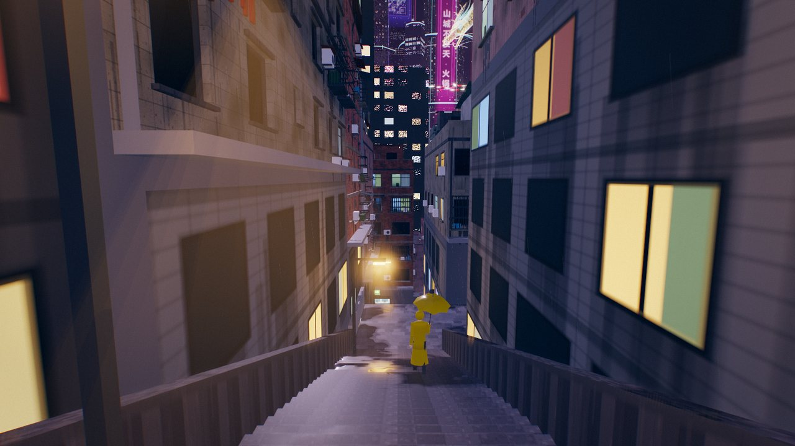 |

**滨江步道**：骑楼街、行道树和江边栏杆，一直延伸到两头；江边还有趸船候船室。

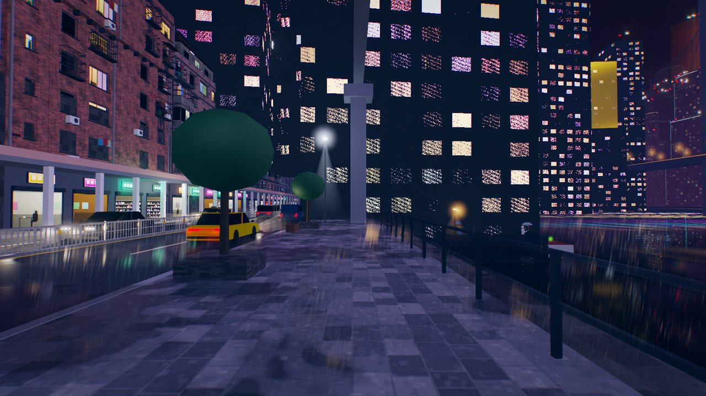

### 细节

**31 间可以推门进去的店**：火锅、面馆、小卖部、茶馆、理发、药房、五金，各有家具、灯管和碰撞。其余店面用"假室内"着色器做出纵深。

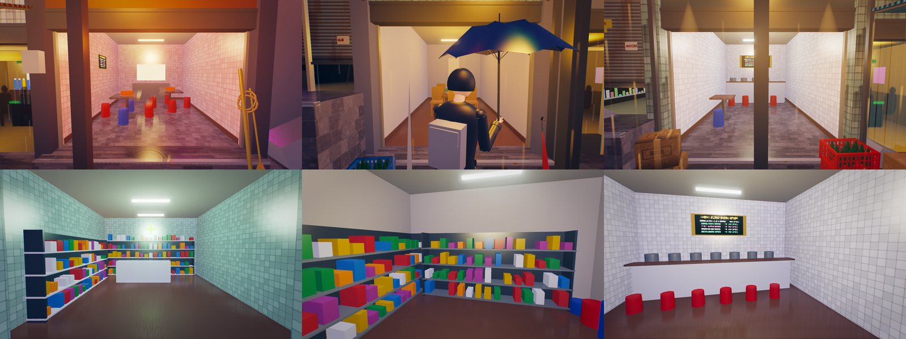

**约 95 个行人**：同一套分段骨架，搭配不同的发型、外套、裙摆、雨衣、背包、口罩、发光目镜，以及透明伞和 LED 伞。

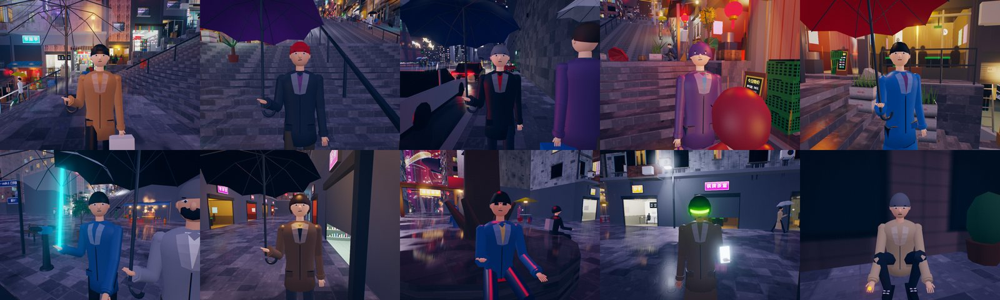

---

## 快速开始

需要 Node.js 18+ 和一个支持 WebGL2 的浏览器（推荐 Chrome / Edge）。

```bash
npm install          # 只装 three（运行时）和 puppeteer-core（截图 / 验收工具）
npm run dev          # 静态服务器
```

浏览器打开 <http://127.0.0.1:5173/?stats>，点击画面进入第一人称。

| 操作 | 按键 |
| --- | --- |
| 行走 / 转向 | `W A S D`（或方向键）+ 鼠标 |
| 奔跑 | `Shift` |
| 切换飞行 | `F`（飞行时 `Space` 上升，`C` 下降） |
| 雨夜 / 阴雨白天 | 左上角按钮，或 URL 加 `?day=1` |
| 探索路线提示 | 左上角「探索路线」 |

> 端口 5173 被占用时 `npm run dev` 会报 `EADDRINUSE`，说明服务器已经在运行，直接打开页面即可。

### URL 参数

| 参数 | 作用 |
| --- | --- |
| `stats` | 显示帧率、分辨率缩放、draw call、三角面、光源数 |
| `day=1` | 以阴雨白天进入 |
| `q=high\|medium\|low` | 画质档（像素比、MSAA、SSR、雨量） |
| `rain=0..1` | 雨势（影响雨丝、湿润与积水反射） |
| `cam=hero\|terrace\|vista\|…` | 预设机位（见 `src/world/layout.js` 的 `CAMS`） |
| `dynres=0` | 关闭动态分辨率 |
| `exposure=` `bloom=` … | 直接覆盖后处理参数 |

---

## 探索路线

1. **主阶梯**：从坡顶沿 20 m 宽的大阶梯一路下到观景平台。两侧平台段有 5 间店可以进门。
2. **梯后老街**：转身穿过坡顶街，后街正中有「梯后老街」牌坊。往里是黄葛树小广场和挂灯笼的横街，再上 30 级梯坎到坡上巷。
3. **两侧梯巷与山坡巷**：坡顶向左右走到楼后的梯巷。巷中「一巷 / 二巷 / 三巷」的路口可以横穿山坡楼群，巷尾的后山梯道把三条巷连成一圈。
4. **滨江**：在观景平台找「滨江步道」标识下到滨江路，南侧骑楼街向两头延伸。江边找「趸船 ↓」，下跳板到候船室。

---

## 技术概览

```
index.html ── src/main.js            启动：渲染器 → 天空 → ctx → 按 layout.MODULES 构建模块 → 静态合批 → 主循环
             ├─ src/core/            核心层：材质库、光场、后处理、物理、玩家、纹理、合批……
             └─ src/world/           场景模块：每个模块导出 build(ctx)，只在 ZONES 划定的区域里放东西
                  layout.js          世界约定：坐标、高程函数、地块、机位、预算、模块顺序
```

- **全程序化**：建筑立面、招牌文字、店内景象、路面与瓷砖都由 Canvas 2D 和几何代码生成，确定性随机数按模块分流，截图可复现。
- **光场**：数百个霓虹 / 路灯 / 店灯登记在 `ctx.lights`，每帧挑对相机贡献最大的 96 个写入浮点纹理，所有材质在片元里累加。不用 three.js 的实时灯光。
- **雨天渲染**：HDR + MSAA，半分辨率 SSR 湿地反射（未命中时退回到远景投影和天空渐变），积水与涟漪函数由材质和 SSR 共用，最后接 Bloom 与调色。
- **雨**：GPU 上按时间计算的雨丝、地面水花、台阶径流和雨棚滴水，用一张高程/遮雨纹理避免雨落进屋里。
- **性能**：静态几何构建后自动按材质合批（上万个网格合成几百个 draw call），行人全部实例化，还有动态分辨率。GTX 1660 Ti、1080p 主视角实测约 75 fps。
- **可走性**：`walkHeightAt` 给出全场可走高程，再加上 AABB 碰撞（建筑、护栏、家具），扩展区的高程由 `layout.DISTRICTS` 定义。

主要模块：`terrain` 地面与阶梯 · `buildingsW/E` 山城居民楼 · `megacity` `hologram` `aircraft` 江对岸巨构城、全息巨人、母舰与飞车 · `shops` `signs` `props` `wires` 街面店铺、招牌、杂物、电线 · `traffic` `characters` 车流与行人 · `exploration` `districts` 可探索区域与可进入店铺 · `weather` 雨。

---

## 开发与验收

| 命令 | 用途 |
| --- | --- |
| `node tools/check.mjs [module]` | 无头构建，检查三角面/光源/纹理预算、越界、材质、NaN；必须输出 `RESULT: OK` |
| `node tools/shot.mjs --cams hero,terrace --out shots/x` | 真实 GPU 截图（Edge/Chrome 无头） |
| `node tools/bench.mjs --cams hero,mid` | GPU 帧时间基准，并逐项关闭后处理对比 |
| `node tools/test-exploration.mjs` | 按玩家同样的碰撞与贴地逻辑走完全部探索路线（含进店） |
| `node tools/test-lighting.mjs` | 日夜切换回归 |

设计规范见 [`docs/DESIGN.md`](docs/DESIGN.md)，各模块任务卡与迭代记录见 [`docs/tasks/`](docs/tasks/)。

---

## 许可

MIT（见 `package.json`）。场景中的店名、招牌、标语均为虚构。
